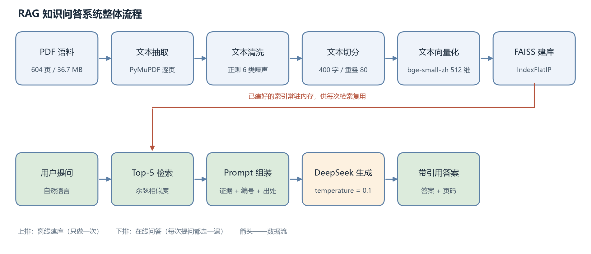
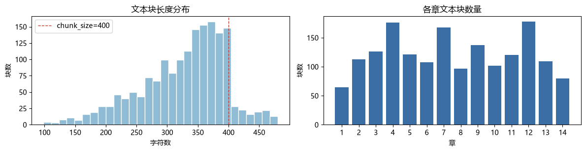
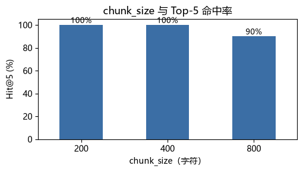

# RAG 教材知识问答系统

> 把一本 604 页的中文教材变成可问答、答案可溯源到具体页码的知识库。

基于检索增强生成（RAG）实现的教材问答系统：从 PDF 解析、文本清洗、语义切分、向量检索到 LLM 生成，全链路自实现，并配有可复现的评估实验与交互式演示页面。



## 效果

| 指标 | 数值 | 说明 |
|---|---|---|
| 检索命中率 | **Hit@1 70% / Hit@3 90% / Hit@5 100%** | 自建 10 题评估集，人工标注答案页码，±10 页容差 |
| 排序质量 | **MRR 0.825** | 正确答案在 Top-5 中的平均倒数排名 |
| 端到端延迟 | **1.9 – 3.1 s** | 检索 80–105 ms，其余为 LLM 生成 |
| 语义检索 vs 关键词 | **3/4 vs 1/4** | 同义改写提问下的 Top-10 覆盖率 |

## 为什么做这个

大模型对某个学科有通用知识，但它没读过**这一本**书：不知道书里怎么定义、分几类、举什么例子，也无法回答"这句话在第几页"。直接微调成本高且仍不可溯源，把整本书塞进上下文则约需 40 万 token，延迟和成本都不可接受。

RAG 的思路是把书变成可检索的向量库，每次提问只送进最相关的 5 个片段（约 690 token），并保留页码用于溯源。

## 系统设计

系统分为两条流水线，共用同一份索引：

```
离线建库（一次）
  PDF 解析 → 噪声清洗 → 递归切分 → 向量编码 → FAISS 索引
                                                    │
在线问答（每次）                                      ↓
  用户提问 → 查询编码 → Top-K 检索 → Prompt 组装 → LLM 生成 → 带引用答案
```

## 关键设计决策

| 环节 | 决策 | 依据 |
|---|---|---|
| 语料范围 | 只索引正文 506 页，丢弃目录 / 参考文献 / 索引页 | 目录与正文语义高度相似，会抢占检索位；参考文献向量无信息量 |
| 文本清洗 | 6 条正则规则，按行删除后再合并软换行 | 删除 12,555 行噪声、占原字符 27.5%。**顺序不可颠倒**：合并换行后行结构消失，无法区分页眉 |
| 切分粒度 | 递归字符切分，400 字 / 重叠 80 | 消融实验：200→MRR 0.658（过碎）、400→**0.825**、800→Hit@5 降至 90%（语义稀释） |
| 嵌入模型 | bge-small-zh-v1.5（512 维） | CPU 环境、1700 块规模小，48 秒编码完成；查询侧加指令前缀，文档侧不加 |
| 索引类型 | FAISS `IndexFlatIP` | 向量已 L2 归一化，内积即余弦。实测 `IndexIVFFlat` 快约 2.4 倍，但 Recall@10 掉到 88.3%，此规模下不划算 |
| 生成控制 | DeepSeek，temperature=0.1 | 知识问答需要稳定复述而非创造；低温度保证同一问题多次回答一致 |

## 快速开始

### 1. 安装依赖

```bash
python -m venv .venv
.venv\Scripts\activate        # Windows
# source .venv/bin/activate   # macOS / Linux
pip install -r requirements.txt
```

### 2. 准备语料

将你的 PDF 放在项目根目录并命名为 `自然语言处理导论.pdf`（本仓库不包含该文件，版权归原作者）。

### 3. 建库

打开并完整执行 `RAG_NLP_知识问答系统.ipynb`，会生成 `rag_index/` 目录（文本块、向量、FAISS 索引）。

> 国内网络需要镜像站下载嵌入模型，代码中已配置 `HF_ENDPOINT=https://hf-mirror.com`。

### 4. 配置大模型

在项目根目录新建 `deepseek_api_key.txt`，把 key 写在第一行：

```
sk-xxxxxxxxxxxxxxxx
```

或设置环境变量 `DEEPSEEK_API_KEY`。未配置时系统运行在「仅检索」降级模式，仍可查看检索证据。

### 5. 启动演示

```bash
python demo_app.py
```

浏览器打开 `http://127.0.0.1:7860`，可交互提问并查看每条答案对应的原文出处。

## 目录结构

```
.
├── RAG_NLP_知识问答系统.ipynb     # 主程序：7 个步骤 + 4 组实验，含完整运行输出
├── RAG_NLP_知识问答系统.html      # 静态导出，双击即可查看，无需环境
├── RAG知识问答系统_实验报告.docx   # 实验报告（约 8300 字，10 表 4 图）
├── RAG知识问答系统_实验报告.pdf
├── demo_app.py                   # Gradio 交互演示
├── 启动演示.bat                   # Windows 一键启动
├── requirements.txt
├── figures/                      # 架构图与实验图表
├── rag_index/                    # 建库产物（不入库，由 Notebook 生成）
└── models/                       # 嵌入模型（不入库，首次运行自动下载）
```

## 实验结果

| 切分粒度消融 | 检索与关键词对比 |
|---|---|
|  |  |

## 已知不足

1. **单路召回、排序不稳**：Hit@1 仅 70%，答案常在第 2–3 位才被召回。改进方向为向量 + BM25 混合召回，再加 cross-encoder 重排。
2. **固定长度切分会切断标题**：存在一个真实失败案例——书中第 462 页第 13.3.2 节确实讲了「同义词替换攻击」，但节标题与正文被切进不同块，Top-5 未召回，模型据实拒答。改进方向是按标题层级切分。
3. **引用编号依赖模型自觉**：未做生成后的引用校验，存在标错可能。
4. **评估集规模小**：仅 10 题，1 题即 10 个百分点，统计意义有限。

## 技术栈

Python · PyMuPDF · sentence-transformers（bge-small-zh-v1.5）· FAISS · DeepSeek API（OpenAI 兼容）· Gradio · pandas · scikit-learn

## 说明

本项目为课程作业，独立完成。代码与文档可自由参考；教材 PDF 不在仓库内，请自行获取。
