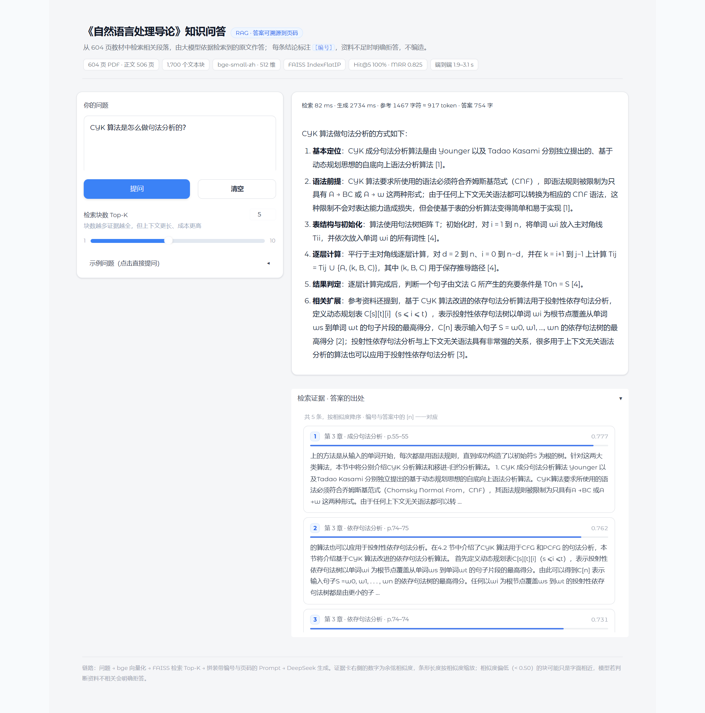

# RAG 教材知识问答系统

把《自然语言处理导论》（604 页）做成一个能问答的知识库。你问一句，它从书里找出几段相关原文，交给大模型照着这些原文回答，答案里的 `[1]` `[2]` 能对到具体页码，翻回去就能核对。

在线演示：<https://hcyddye.github.io/RAG-textbook/>，不用装环境，打开就能点。

Notebook 里按读取、清洗、切分、建库、检索、生成、评估的顺序走了一遍，每格的输出都留着，包括耗时和召回率。


## 界面预览



左边输入问题或者点示例，右边上半部分是答案，下半部分是检索到的原文片段，带章节、页码和相似度分数。

不想配环境的话直接打开[在线演示](https://hcyddye.github.io/RAG-textbook/)，或者双击仓库里的 `RAG界面.html`，两个是同一份页面。里面存了 6 组跑好的问答，纯静态文件，不调 API。

## 效果

| 指标 | 数值 | 说明 |
|---|---|---|
| 检索命中率 | Hit@1 70% / Hit@3 90% / Hit@5 100% | 自建 10 题评估集，人工标注答案页码，±10 页容差 |
| 排序质量 | MRR 0.825 | 正确答案在 Top-5 中的平均倒数排名 |
| 端到端延迟 | 1.9 – 3.1 s | 检索 80–105 ms，其余为 LLM 生成 |
| 语义检索 vs 关键词 | 3/4 vs 1/4 | 同义改写提问下的 Top-10 覆盖率 |

## 为什么做这个

大模型知道自然语言处理大概是怎么回事，但它没读过这本书。某个概念书里怎么定义、分成几类、用了什么例子、在哪一页，它都答不上来。直接微调成本高，而且照样溯源不了；把整本书塞进上下文要 40 万 token 左右，又慢又贵。

RAG 的做法是把书切成块、编码成向量存起来。提问时只捞最相关的 5 块送进去，大概 690 token，页码跟着一起送，所以答案能指回原书。

## 系统设计

建库和问答是两条线，共用同一份索引：

```
离线建库（一次）
  PDF 解析 → 噪声清洗 → 递归切分 → 向量编码 → FAISS 索引
                                                    │
在线问答（每次）                                      ↓
  用户提问 → 查询编码 → Top-K 检索 → Prompt 组装 → LLM 生成 → 带引用答案
```

## 关键设计决策

| 环节 | 决策 | 依据 |
|---|---|---|
| 语料范围 | 只索引正文 506 页，目录、参考文献、索引页都丢掉 | 目录和正文措辞太像，检索时容易把目录顶上来；参考文献没有实质内容 |
| 文本清洗 | 6 条正则按行删噪声，再合并软换行 | 删掉 12,555 行，占原字符 27.5%。顺序不能反：先合并换行的话行结构就没了，页眉和正文分不开 |
| 切分粒度 | 递归字符切分，400 字，重叠 80 | 试过 200 字，切得太碎，MRR 掉到 0.658；400 字是 0.825；800 字时 Hit@5 掉到 90%，一段里混了太多主题 |
| 嵌入模型 | bge-small-zh-v1.5，512 维 | 跑在 CPU 上，1700 块的规模也不大，编码 48 秒完事。查询侧加指令前缀，文档侧不加 |
| 索引类型 | FAISS `IndexFlatIP` | 向量都做过 L2 归一化，内积就是余弦。`IndexIVFFlat` 快 2.4 倍，但 Recall@10 掉到 88.3%，这个规模不值 |
| 生成控制 | DeepSeek，temperature=0.1 | 这类问答要的是照着书复述，不是发挥。温度压低，同一个问题问两遍答案基本一致 |

## 快速开始

### 1. 安装依赖

```bash
python -m venv .venv
.venv\Scripts\activate        # Windows
# source .venv/bin/activate   # macOS / Linux
pip install -r requirements.txt
```

### 2. 准备语料

把 PDF 放到项目根目录，命名成 `自然语言处理导论.pdf`。仓库里没有这个文件，版权归原作者。

### 3. 建库

完整跑一遍 `RAG_NLP_知识问答系统.ipynb`，会生成 `rag_index/`（文本块、向量、FAISS 索引）。

> 国内网络下模型要挂镜像，代码里已经写好了 `HF_ENDPOINT=https://hf-mirror.com`。

### 4. 配置大模型

在项目根目录新建 `deepseek_api_key.txt`，key 写在第一行：

```
sk-xxxxxxxxxxxxxxxx
```

或者设环境变量 `DEEPSEEK_API_KEY`。不配也能跑，只是退化成「只检索」模式，能看证据，看不到生成的答案。

### 5. 启动演示

Windows 直接双击 `启动演示.bat`，或者命令行：

```bash
python demo_app.py
```

浏览器打开 `http://127.0.0.1:7860`，可以自己输问题，每条答案下面能看到它引用的原文。服务已经在跑的时候再双击 bat，不会重复启动，会直接把浏览器打开。

只想看效果、不装环境：打开[在线演示](https://hcyddye.github.io/RAG-textbook/)，或者双击 `RAG界面.html`。

> 在 GitHub 网页上点 `启动演示.bat` 只会看到源码。它得先装 Python、下模型、建索引、配 Key 才能跑起来，不适合当「点开即看」的入口。看效果用在线演示。

## 目录结构

```
.
├── RAG_NLP_知识问答系统.ipynb     # 主程序：7 个步骤 + 4 组实验，含完整运行输出
├── RAG_NLP_知识问答系统.html      # 静态导出，双击即可查看，无需环境
├── RAG界面.html                  # 离线演示页（单文件，内置 6 组真实问答）
├── demo_app.py                   # Gradio 交互演示
├── build_static.py               # 生成上述离线演示页
├── 启动演示.bat                   # Windows 一键启动
├── requirements.txt
├── figures/                      # 架构图、界面截图与实验图表
├── rag_index/                    # 建库产物（不入库，由 Notebook 生成）
└── models/                       # 嵌入模型（不入库，首次运行自动下载）
```

## 实验结果

| 切分粒度消融 | 检索与关键词对比 |
|---|---|
|  |  |

## 已知不足

1. **单路召回，排序不稳**。Hit@1 只有 70%，正确答案经常排到第 2、3 位才出来。要改的话，可以让向量和 BM25 一起召回，再加一层 cross-encoder 重排。
2. **固定长度切分会切断标题**。有个真实的例子：书里第 462 页 13.3.2 节确实讲了「同义词替换攻击」，但节标题和正文被切进了不同的块，Top-5 没捞到，模型就据实说没有。按标题层级切能避开这个问题。
3. **引用编号靠模型自觉**。没做生成后的引用校验，标错了也发现不了。
4. **评估集只有 10 题**。一道题就是 10 个百分点，统计意义有限。

## 技术栈

Python · PyMuPDF · sentence-transformers（bge-small-zh-v1.5）· FAISS · DeepSeek API（OpenAI 兼容）· Gradio · pandas · scikit-learn
